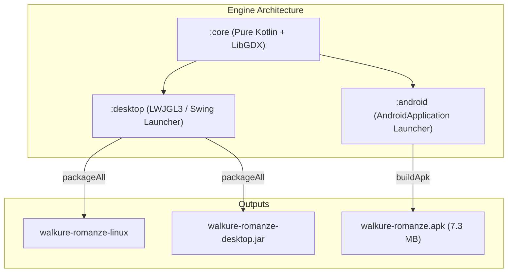

# Walkure Romanze — Android Build & Playing Guide

This guide explains how to compile the **Walkure Romanze** Android `.apk` and run the game on any Android phone or tablet (Android 7.0+ / API 24 to Android 15+ / API 36+), **without needing Android Studio or the heavy Android developer suite**.

### Prerequisites

- Git to clone the repository.
- JDK 21 for the project toolchain. The wrapper downloads Gradle 9.6.1; its configured JDK 25 daemon may be downloaded on the first Gradle run. The SDK setup scripts do not install Java.
- Internet access for Gradle, dependencies, the daemon JDK, and Android SDK packages.
- Android SDK `platform-tools`, `platforms;android-36`, and `build-tools;36.0.0`. The setup scripts install these packages; Gradle generates the ignored native libraries automatically.
- Your own game installation to play: `GameData/data*.pack` and a valid `GameData/walkure.keys`. The restore script can generate the key from the local executable and DLL. The custom font and startup logo are optional.

Optional tools: `ffmpeg` extracts/converts the startup logo and transcodes OGV cutscenes; ADB (included in `platform-tools`) is only needed for USB transfer. On Linux/macOS, the headless SDK setup also needs `curl` or `wget` and `unzip`; the Windows script uses built-in PowerShell.

**Windows has not been tested:** the APK build and Windows batch scripts are unverified there.

---

## 🚀 2 Ways to Build the `.apk`

### Method 1: Local 1-Command Build (SDK Already Installed)
If you already have an Android SDK (or Android Studio) configured:
```bash
# Linux / macOS
./gradlew buildApk

# Windows
.\gradlew.bat buildApk
```
The compiled, self-contained APK is saved to:
```
build/dist/walkure-romanze.apk
```

---

### Method 2: Minimal Headless Setup (No Android Studio Required)
If you do **not** have an Android SDK and do **not** want to download the 3+ GB Android Studio IDE:

#### On Linux / macOS:
```bash
# 1. Run the headless setup script (downloads ~140 MB official Google commandline-tools)
bash scripts/setup-android-sdk.sh

# 2. Build the APK
./gradlew buildApk
```

#### On Windows:
```bat
rem 1. Run the headless setup script
.\scripts\setup-android-sdk.bat

rem 2. Build the APK
.\gradlew.bat buildApk
```
This script downloads only the official Google headless command-line tools into `~/.android-sdk/`, accepts licenses automatically, and configures `local.properties`.

---

## 📦 Game Data & Cryptographic Keys

*Walkure Romanze* is a commercial visual novel; game archives (`data0.pack`..`data15.pack`, ~3.9 GB) are not redistributed inside the git repository. Anyone who owns the PC game can easily play:

### 1. Clone and Restore Local Assets
Clone this repository into a subfolder of your own game installation folder, then restore the ignored Android assets:

```bash
cd "/path/to/Walkure Romanze"
git clone https://github.com/Forgeron-dest/WalkureRomanze-Engine.git walkure-kotlin
cd walkure-kotlin
bash scripts/restore-game-assets.sh
```

On Windows, use PowerShell:
```powershell
Set-Location 'C:\path\to\Walkure Romanze'
git clone https://github.com/Forgeron-dest/WalkureRomanze-Engine.git walkure-kotlin
Set-Location .\walkure-kotlin
.\scripts\restore-game-assets.bat
```
Neither Git Bash nor WSL is required.

The script generates `GameData/walkure.keys` from the local executable and DLL if needed, copies the key and custom font into ignored Android assets, and restores the launcher icon from Mio's game portrait in the local archive. If `ffmpeg` is installed, it also extracts and converts the startup logo. Missing optional font/logo assets do not prevent building.

### 2. Decryption Keys, Font & Logo Movie (Local Builds)
When building locally after restoring assets, Gradle **automatically bundles**:
- `walkure.keys` (the 512-byte portable decryption keys)
- `WalkureCustomV4.ttf` (the custom visual novel translation TTF font)
- `ricotta_logo.mp4` (hardware-accelerated startup logo movie)

into the APK's internal assets. Mobile users **never need the Windows `.exe` or Delphi DLLs** on their phone!

Gradle downloads the declared dependencies and generates the ignored Android native libraries during the build; do not copy `android/libs` from another installation or commit it.

### 3. Copying Game Data (`data0.pack`..`data15.pack` & `movie/`) to Your Phone

You can provide the game archives and cutscenes to your Android device using any of these 3 easy methods:

#### Option A: USB File Transfer (MTP) — Recommended
1. Connect your Android device to your computer via USB.
2. In the Android notification dropdown, set USB mode to **File Transfer (MTP)**.
3. Open your phone's storage on your PC and navigate to:
   ```
   Android/data/org.walkure.android/files/
   ```
   *(or create a folder named `Walkure` in your phone's internal storage)*.
4. Copy your PC game's `GameData` folder (all `data*.pack` files and `movie/` cutscenes) into that directory.
5. Open the **Walkure Romanze** app on your phone and tap **Launch Game**!

#### Option B: In-App Folder Picker (Storage Access Framework)
1. Install and launch the APK.
2. If game data is not yet found, the app displays a friendly setup screen.
3. Tap **📁 Select Game Folder**.
4. Browse to any folder on your internal storage or SD card where you stored your `GameData` archives.
5. The app verifies the archives and starts immediately!

#### Option C: One-Click ADB Push (For Developers)
If you have USB debugging enabled:
```bash
bash scripts/push-game-data.sh
```
This detects your phone and pushes the `data*.pack` archives, `walkure.keys` when available, and movie cutscenes to the app's files directory over USB. If `ffmpeg` is installed, it also creates MP4 versions of OGV cutscenes for Android.

On Windows, run `.\scripts\push-game-data.bat` from Command Prompt or PowerShell; it looks for ADB on `PATH` or in common Android SDK locations.

---

## 🎮 Touch Controls

| Touch Gesture / Input | Game Action |
| :--- | :--- |
| **Tap Screen** | Advance dialogue / Select choice / Confirm button |
| **Tap during Movie** | Skip video cutscene (Logo, OP, ED) |
| **Two-Finger Tap** | Hide / Show Message Window (View full CG) |
| **Swipe Down** | Toggle Backlog / Dialogue History |
| **Swipe Right** | Toggle Skip Mode |
| **Android Back Button** | Open In-Game Menu / Return to Title Screen |
| **Volume Buttons** | Adjust Master Game Volume |

---

## 🛠️ Architecture Summary



- **`:core`**: 100% platform-independent engine logic (QLiE VFS, BPE decompressor, script VM, audio manager, transition shaders, Pixmap decoders).
- **`:desktop`**: LWJGL3 OpenGL runner, Swing viewer, Linux executable and Windows launcher packagers.
- **`:android`**: Android application launcher with native `.so` binaries (`arm64-v8a`, `armeabi-v7a`, `x86_64`, `x86`), asset extraction, and storage resolution.
